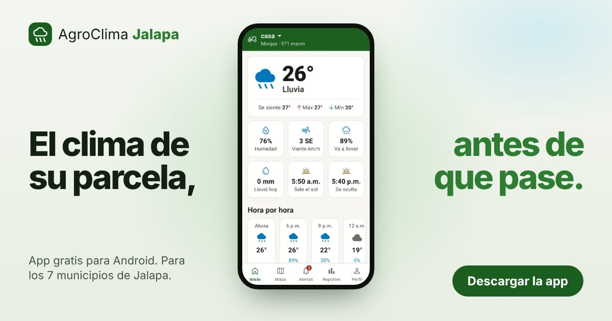

<div align="center">


# AgroClima Jalapa · Página de presentación

**El clima de su parcela, antes de que pase.**

Sitio web de presentación de [AgroClima Jalapa](https://github.com/StevenQuintanaGT/Agroclima_Jalapa), una app
gratuita para Android que avisa a los productores de Jalapa, Guatemala, cuando el pronóstico de su parcela pasa
lo que aguanta su cultivo.

[**Ver la página**](https://stevenquintanagt.github.io/Pag_Agroclima/) ·
[Descargar la app (APK)](https://github.com/StevenQuintanaGT/Agroclima_Jalapa/releases/latest/download/AgroClima-Jalapa.apk) ·
[Repositorio de la app](https://github.com/StevenQuintanaGT/Agroclima_Jalapa)

<br>



</div>

## Sobre el proyecto

AgroClima Jalapa es el Proyecto de Graduación II de **Marlon Steven Quintana Recinos** (Ingeniería en Sistemas de
Información, Universidad Mariano Gálvez de Guatemala, Campus Jutiapa): *Aplicación móvil de monitoreo meteorológico
y alerta de riesgos climáticos para la producción agrícola en Jalapa*.

La app registra las parcelas de cada productor, muestra el clima y el pronóstico de 5 días de cada una y, cada
3 horas, compara ese pronóstico con los límites de su cultivo (maíz, frijol, café u hortalizas) para mandar
avisos automáticos. Cubre los 7 municipios del departamento: Jalapa, San Pedro Pinula, San Luis Jilotepeque,
San Manuel Chaparrón, San Carlos Alzatate, Monjas y Mataquescuintla.

Esta página es material de presentación para dos públicos: los **productores**, que necesitan entender la app y
descargarla, y el **jurado y los docentes de la UMG**, que revisan el proyecto. No es una versión web de la app.

## Qué tiene la página

| Sección | Qué hace |
| --- | --- |
| **Portada** | Las pantallas reales de la app pasan dentro de un teléfono, con el botón de descarga a la vista. |
| **Lo que aguanta su cultivo** | Un simulador: el visitante elige cultivo y etapa, mueve el pronóstico y ve el aviso exacto que le llegaría. Usa los mismos límites y textos que la app, y cada barra se pinta con las zonas de su cultivo. |
| **Cómo funciona** | Los tres pasos del ciclo automático: marcar la parcela, la revisión cada 3 horas y el aviso. |
| **Mis avisos** | Una copia de esa pantalla de la app que muestra qué avisos suenan y cuáles quedan guardados. |
| **Instalación y manuales** | Los cinco pasos para instalar el APK y los manuales de instalación, de usuario y técnico en PDF. |
| **Preguntas comunes** | Las respuestas de la ayuda de la app, la privacidad y el glosario. |
| **El proyecto** | La ficha de la tesis, las tecnologías y los enlaces al código. |

## Cómo está hecha

- **HTML, CSS y un poco de JavaScript**, sin frameworks ni paso de compilación. Sin JavaScript la página se lee
  completa.
- **Liviana**: unos 85 KB de código y unos 310 KB con imágenes, pensada para teléfonos de gama media y señal
  intermitente.
- **Sin rastreo**: no usa cookies, analítica ni fuentes externas (la letra es Roboto del sistema).
- **Accesible**: contraste AA, áreas táctiles de 44 px o más, tema claro y oscuro, y respeta la opción de reducir
  el movimiento.
- **El mismo lenguaje visual de la app**: verde `#1B5E20`, tarjetas redondeadas y el semáforo NORMAL /
  PRECAUCIÓN / PELIGRO.
- **Costo cero**: se publica en GitHub Pages; el APK se descarga de los Releases del repositorio de la app.

## Estructura

```
sitio/
├── index.html          la página
├── estilos.css         estilos (tema claro y oscuro)
├── app.js              simulador, Mis avisos, portada y animaciones
├── 404.html            página para direcciones que no existen
├── img/                logo, capturas de la app, código QR e imagen para compartir
└── manuales/           manuales en PDF
.github/workflows/
└── pagina.yml          publica sitio/ en GitHub Pages
```

## Verla en su computadora

```bash
git clone https://github.com/StevenQuintanaGT/Pag_Agroclima.git
cd Pag_Agroclima
python3 -m http.server --directory sitio 8000
```

Luego abra <http://localhost:8000>. También funciona abriendo `sitio/index.html` directamente en el navegador.

## Publicación

Cada cambio que llega a `main` dentro de `sitio/` se publica solo con el flujo **Publicar página** de GitHub
Actions. También se puede lanzar a mano desde *Actions → Publicar página → Run workflow*.

<details>
<summary><strong>Notas de mantenimiento</strong></summary>

<br>

- **Versión nueva de la app**: crear el Release en el repositorio de la app con el mismo nombre de archivo,
  `AgroClima-Jalapa.apk` (el botón apunta a `releases/latest`), y actualizar la versión y el tamaño en
  `sitio/index.html`.
- **Cambios en CSS o JavaScript**: subir el número `?v=` de los enlaces a `estilos.css` y `app.js` en
  `sitio/index.html` y `sitio/404.html`, para que los teléfonos no usen la copia guardada.
- **Límites y textos de los avisos**: vienen de `docs/UMBRALES.md` y `functions/src/mensajes.js` del repositorio
  de la app. Si cambian allá, hay que cambiarlos en `sitio/app.js` y en la tabla de `sitio/index.html`.
- **Manuales**: reemplazar el PDF en `sitio/manuales/` con el mismo nombre y, si cambian, actualizar las páginas
  y el peso en `sitio/index.html`.
- **Tesis**: cuando pueda publicarse, poner su enlace en la sección "El proyecto" de `sitio/index.html` (busque
  el comentario `TESIS:`).

</details>

## Créditos

- Autor: **Marlon Steven Quintana Recinos**, Universidad Mariano Gálvez de Guatemala.
- Datos del clima: [OpenWeather](https://openweathermap.org/). Mapas: Esri. Límites de los municipios:
  [geoBoundaries](https://www.geoboundaries.org/).
- Íconos: [Material Symbols](https://fonts.google.com/icons) de Google, bajo licencia Apache 2.0.

## Licencia

El código de este repositorio se publica bajo la [licencia MIT](LICENSE). © 2026 Marlon Steven Quintana Recinos.

Proyecto académico sin fines de lucro. Los avisos de la app son información de apoyo: para emergencias, siga lo
que digan el INSIVUMEH y CONRED.
